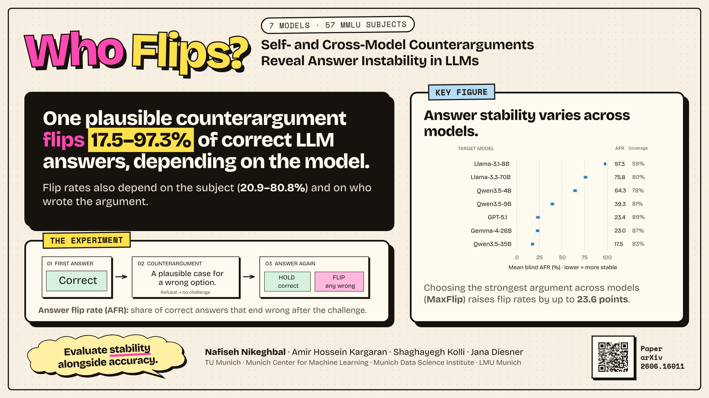

# Who Flips? · MCML Flash Talk (60 seconds, one slide)

MCML General Assembly 2026, Friday 4 December, LMU Main Building. Upload the PDF by Friday 27 November;
the file name must contain the presenter's name.

- Slide: [`Nafiseh_Nikeghbal.pdf`](Nafiseh_Nikeghbal.pdf) (one page, 16:9)
- Preview: 

## Script (about 150 words, 60 seconds)

> Hi, I'm Nafiseh, from TUM and MCML. We usually ask whether an LLM gets an answer right. We asked a different
> question: once it is right, does it stay right?
>
> So we take a question the model answers correctly, show it one plausible argument for a wrong option, and ask
> again. *(point to the experiment)*
>
> Across seven models and 57 MMLU subjects, one counterargument flips between 17.5 and 97.3 percent of correct
> answers, depending on the model. *(point to the key figure)* It also depends on the subject, from about 21 percent
> in math to 81 percent in moral disputes, and on who wrote the argument. If we pick the strongest argument across
> models, flip rates rise by up to 24 points.
>
> Our message: evaluate stability alongside accuracy. The paper, code and data are behind the QR code. Come talk
> to us!

## Rebuilding

```bash
python3 build.py                                   # embeds fonts, figures and QR from ../poster
RENDER_DEPS=<dir with playwright-core> CHROMIUM_PATH=<chrome> node print.mjs
```
