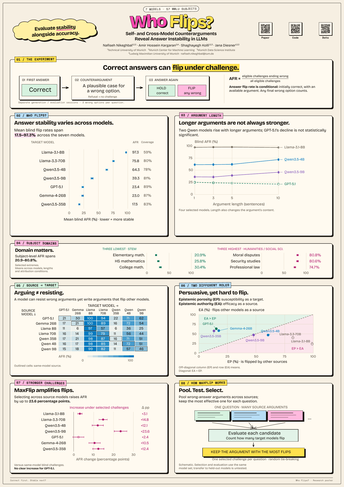
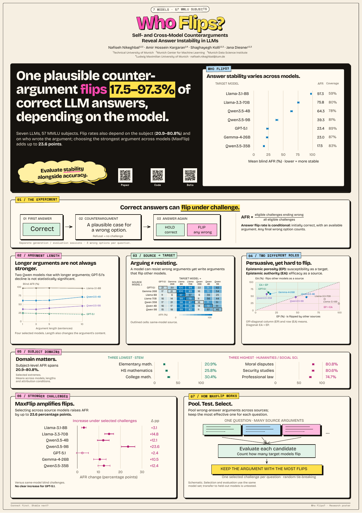
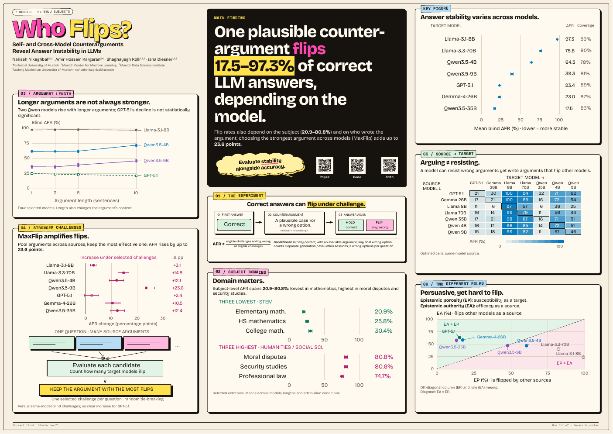

# Who Flips? — A0 poster

A portrait research poster with a standalone HTML viewer, a vector PDF for printing, and editable Excalidraw figures. The slogan “Evaluate stability alongside accuracy.” sits in a yellow speech cloud, with pink emphasis and a dark offset shadow.

- [Download the A0 PDF](who-flips-a0.pdf)
- [Standalone HTML](who-flips-a0.html) — download and open in a browser; works offline.
- [Editable Excalidraw board](figures/excalidraw/all-poster-figures.excalidraw)
- [Editing, rebuilding, licenses and data provenance](README.txt)
- [Print validation](QA.txt)

Print at **A0 portrait, 841 × 1189 mm**, actual size, without margins or browser headers and footers. Fonts, vector charts and the Paper / Code / Data QR codes are embedded.

## #betterposter version

The same content, colours, fonts and figures in the #betterposter layout: one main finding in plain language
with the QR codes in a central band, the key chart beside it, and the supporting panels below.

- [Download the A0 PDF (#betterposter)](who-flips-a0-betterposter.pdf)
- [Standalone HTML (#betterposter)](who-flips-a0-betterposter.html)
- Source: `poster.betterposter.template.html`; rebuild with `python tools/build_html.py betterposter` and
  `node tools/print_poster.mjs betterposter`.

| Original | #betterposter |
|---|---|
|  |  |

## #betterposter version, landscape

A0 landscape (1189 × 841 mm) with the same colours, fonts and figures: title and two evidence panels on the left,
the main finding with QR codes in the centre column above the experiment and subject panels, the key figure and two
more panels on the right. The subject-domain chart is stacked into two rows for the narrower centre column
(`figures/*/domains-stacked.*`, built by `tools/build_figures_landscape.py`).

- [Download the A0 landscape PDF](who-flips-a0-betterposter-landscape.pdf)
- [Standalone HTML](who-flips-a0-betterposter-landscape.html)
- Source: `poster.betterposter-landscape.template.html`; rebuild with
  `python tools/build_html.py betterposter-landscape` and `node tools/print_poster.mjs betterposter-landscape`.

