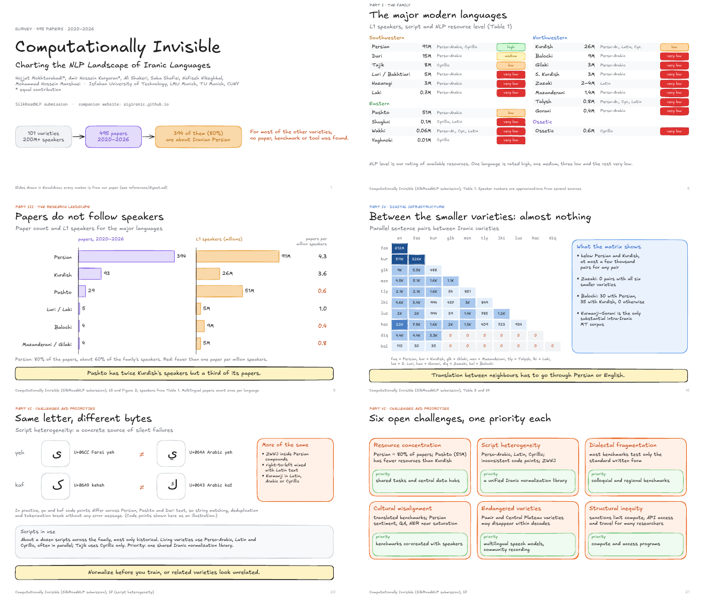

# Computationally Invisible: Charting the NLP Landscape of Iranic Languages

Hojjat Mokhtarabadi\*, Amir Hossein Kargaran\*, Ali Shakeri, Saba Shafiei, Nafiseh Nikeghbal, Mohammad Hossein Manshaei
(\* equal contribution). SilkRoadNLP submission. Companion website: [sigiranic.github.io](https://sigiranic.github.io).

| What | Where |
|---|---|
| Clickable deck (arrow keys, `N` notes, `O` overview, `F` full screen) | [`slides/index.html`](slides/index.html) |
| PDF (24 slides, 16:9) | [`slides/iranic-nlp.pdf`](slides/iranic-nlp.pdf) |
| Speaker notes (story first, then a script per slide) | [`slides/speaker-notes.md`](slides/speaker-notes.md) |
| Editable Excalidraw file per slide | [`slides/excalidraw/`](slides/excalidraw), open on excalidraw.com (menu → Open) |
| A0 poster (#betterposter) | [`poster/`](poster/) |
| Every number used, with its table or section | [`references/digest.md`](references/digest.md) |



## Outline (24 slides)

1 Title · 2 Our survey in one slide · 3 Glossary
- **Part I, the family:** 4 101 codes in four branches · 5 the major languages · 6 what counts as one language
- **Part II, method:** 7 from 5,878 candidates to 495 papers
- **Part III, landscape:** 8 papers vs speakers · 9 papers per year · 10 tasks
- **Part IV, infrastructure:** 11 digital footprint · 12 Wikipedia · 13 morphology · 14 language identification ·
  15 parallel data with English · 16 parallel data between varieties
- **Part V, tasks:** 17 Persian vs the other varieties · 18 saturation and open frontiers · 19 transfer
- **Part VI, challenges:** 20 script heterogeneity · 21 six challenges · 22 three immediate priorities
- **Part VII:** 23 contributions, scope and next steps · 24 takeaways

All figures are drawn in Excalidraw from the paper's tables; no figures are copied. The Unicode code points on
slide 20 are an illustration of the ya/kaf issue described in §7.

## Editing

Same toolchain as the VideoJev and QARM decks. Edit the source, not the files in `slides/`.

- `tools/slides.py`: one function per slide; order = the `SLIDES` list at the bottom.
- `tools/notes.py`: speaker notes (`STORY` + one note per slide slug).
- `tools/slidekit.py`: palette and drawing helpers.

```bash
pip install --break-system-packages fonttools brotli pillow
cd tools/render && npm ci && npx esbuild entry.js --bundle --format=iife --outfile=dist/bundle.js \
  --loader:.css=empty --define:process.env.NODE_ENV='"production"' --minify --log-level=error && cd ../..
tools/preview.sh 8 16           # rebuild two slides, PNGs in /tmp/slide-previews
tools/build_all.sh              # everything: .excalidraw, .svg, PDF, HTML deck, notes
```
