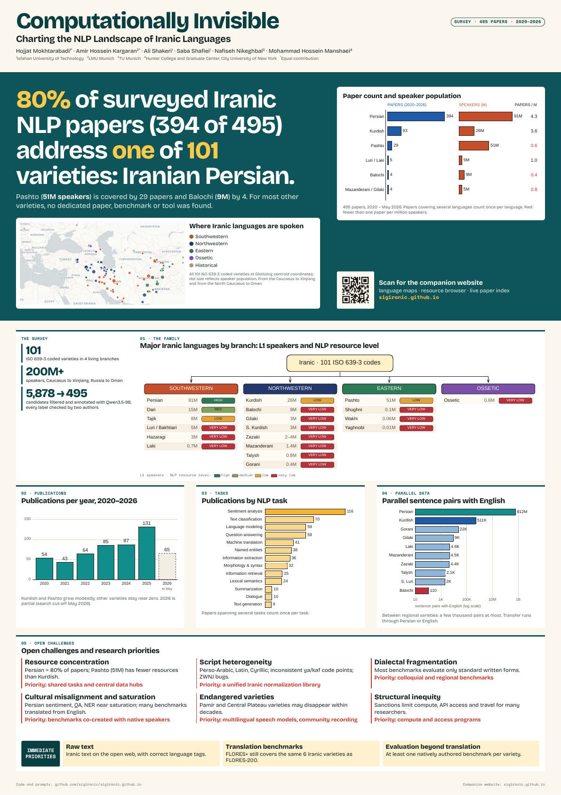

# Computationally Invisible: A0 poster

Poster for *Computationally Invisible: Charting the NLP Landscape of Iranic Languages*
(Hojjat Mokhtarabadi\*, Amir Hossein Kargaran\*, Ali Shakeri, Saba Shafiei, Nafiseh Nikeghbal, Mohammad Hossein Manshaei;
SilkRoadNLP submission). Companion website: [sigiranic.github.io](https://sigiranic.github.io).

- [Download the A0 PDF](iranic-nlp-a0.pdf)
- [Standalone HTML](iranic-nlp-a0.html): download and open in a browser; works offline.
- Editable Excalidraw figures: [`figures/excalidraw/`](figures/excalidraw) (open on excalidraw.com, menu → Open)

Layout follows the #betterposter style: one main finding in plain language with a QR code, supporting evidence below.
Print at **A0 portrait, 841 × 1189 mm**, actual size, without margins or browser headers and footers.
Fonts (Bricolage Grotesque, Space Mono; SIL OFL, see [`licenses/`](licenses)), vector charts and the QR code are embedded.

All numbers come from the paper's tables and text. The map is the paper's `map.png` (Glottolog centroids), cropped to the main
area; two historical varieties in Hungary and Ukraine fall outside the crop.



## Rebuilding

```bash
cd tools
python3 build_figures.py            # figures/src/*.json → figures/excalidraw/*.excalidraw
npm install                         # playwright-core + Excalidraw for headless rendering
CHROMIUM_PATH=/path/to/chrome node render_figures.mjs   # → figures/svg, figures/pdf
python3 build_html.py               # embeds fonts, SVGs, map and QR → iranic-nlp-a0.html
CHROMIUM_PATH=/path/to/chrome node print_poster.mjs     # → iranic-nlp-a0.pdf (A0)
```

Text and layout live in `poster.template.html`; chart data lives in `tools/build_figures.py`.
The `wiki` and `pipeline` figures are built but not used on the current poster.
